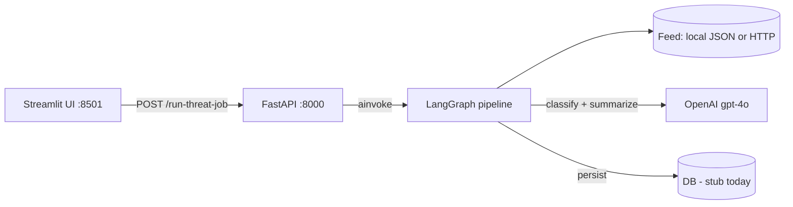
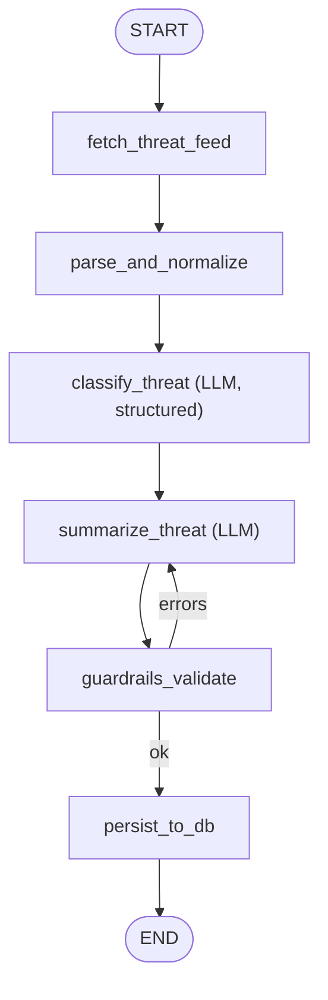
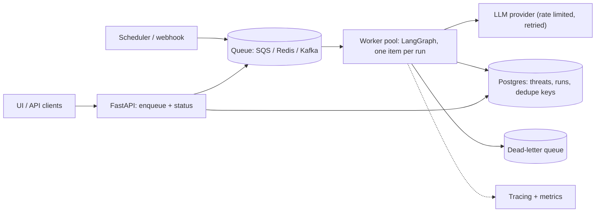

# Threat Intelligence Summarizer

A FastAPI + LangGraph service that ingests threat-intelligence feed items, classifies them with an LLM, produces an executive summary, validates the output, and stores it. A Streamlit UI triggers the pipeline and shows the result.

- **Backend:** FastAPI, LangGraph, LangChain (`ChatOpenAI`, gpt-4o), Pydantic v2
- **UI:** Streamlit
- **Status:** working prototype. The LLM steps, validation and UI are real; persistence is a stub. See [Known gaps](#6-known-gaps-and-how-i-would-fix-them).

---

## 1. How to run

### Prerequisites
- Python 3.11+
- An OpenAI API key

### Setup (once)
```bash
python -m venv .venv && source .venv/bin/activate
pip install -r requirements.txt
echo "OPENAI_API_KEY=sk-..." > .env      # required; the app fails at import without it
# optional: DATABASE_URL=sqlite:///./threat_intel.db
```

### Start the backend (terminal 1)
```bash
uvicorn app.main:app --reload            # http://localhost:8000  (Swagger UI at /docs)
```
Check it and run the pipeline:
```bash
curl http://localhost:8000/health
curl -X POST http://localhost:8000/run-threat-job
```

### Start the UI (terminal 2)
```bash
streamlit run ui/streamlit-app/Home.py   # http://localhost:8501
```
1. The sidebar shows **Backend online/offline**. The backend URL defaults to `http://localhost:8000`; override it in the sidebar or with the `API_URL` env var.
2. Click **Run threat job**. It calls `POST /run-threat-job` and waits (timeout 300 s).
3. The page shows title, threat type, severity badge, stored-record count, the summary, any validation errors, and a raw JSON expander.

### Optional
- **LangGraph Studio / dev server:** `langgraph dev` (config in [langgraph.json](langgraph.json), graph `threat_intel_graph`).
- **Docker (API only):** `docker compose -f infra/docker-compose.yml up --build`. Pass `OPENAI_API_KEY` yourself; the compose file does not do this yet.
- **API response shape:**
  ```json
  {"db_ids": ["T-1760000000"], "validation_errors": [], "threat_type": "RCE",
   "severity": "Critical", "title": "...", "summary": "..."}
  ```

---

## 2. Problem and requirements

**Problem:** analysts get far more threat advisories than they can read. Automate triage: normalize the feed, classify the threat, write a short executive summary, and make sure the output is safe and well-formed before it is stored.

**Functional:** ingest a feed (local file or HTTP JSON); classify type and severity; summarize in at most 590 characters; validate; persist; expose via HTTP; give analysts a UI.

**Non-functional:**
| Concern | Target |
|---|---|
| Correctness / hallucination | Never invent CVEs or products; validate structure and content |
| Latency | LLM-bound, seconds per item, so long jobs should be async at scale |
| Cost | Two LLM calls per item; bound retries; cache by content hash |
| Reliability | Retries with a cap, idempotent writes, graceful LLM failures |
| Observability | Trace every node (LangSmith/OpenTelemetry), log validation failures |
| Security | Secrets via env, prompt-injection resistance (feeds are untrusted input) |

---

## 3. High-level design

Full diagrams (component, pipeline, sequence, state) are in [docs/architecture.md](docs/architecture.md). The core view:



### The pipeline



| Node | File | What it does |
|---|---|---|
| `fetch_threat_feed` | [fetch_nodes.py](app/nodes/fetch_nodes.py) | Async. If `feed_url` starts with `http`, GET it with `httpx` (20 s timeout); otherwise read `sample_path`. |
| `parse_and_normalize` | [parse_nodes.py](app/nodes/parse_nodes.py) | Takes `items[current_index]`, maps to `normalized_item` (title, description, source, published_at, raw). |
| `classify_threat` | [classify_nodes.py](app/nodes/classify_nodes.py) | `llm.with_structured_output(ThreatClassification)` behind a system prompt. Returns typed `threat_type` and `severity`. |
| `summarize_threat` | [summarize_nodes.py](app/nodes/summarize_nodes.py) | LLM writes the summary (cut to 590 chars). CVE ID by regex, affected products by keyword list, recommended action is a fixed string. |
| `guardrails_validate` | [validate_nodes.py](app/nodes/validate_nodes.py) | Builds a `ThreatSummary` Pydantic model (length limits) plus a "no URLs" rule. Writes `validation_errors`. |
| `persist_to_db` | [persist_nodes.py](app/nodes/persist_nodes.py) | **Stub:** prints the record and appends a fake `T-<timestamp>` ID to `db_ids`. |

### Key design decisions (and why)

1. **LangGraph instead of a plain function chain.** The pipeline has a conditional loop (validate, then retry). A state graph makes that explicit, gives checkpointing/streaming/Studio for free, and lets nodes be swapped or added (e.g. dedupe, enrichment) without rewriting control flow.
2. **Shared `TypedDict` state** ([threat_state.py](app/node_models/threat_state.py)). Each node reads and writes named keys. This is simple and inspectable. The cost is weak typing across nodes (all keys optional with `total=False`).
3. **Structured output for classification, free text for summary.** Classification is a closed-form task, so schema-bound output removes the parsing fragility of "Threat Type: X" text. Summaries are prose and then checked by the validator.
4. **Deterministic extraction where possible.** CVE IDs come from a regex on the source text, not from the LLM, which removes the biggest hallucination risk (the system prompt also forbids invented CVEs).
5. **Validate after generation, then route.** Output is checked against a schema and content rules before anything is stored. Validation failure loops back to summarization.
6. **`temperature=0`** for repeatable output, which suits triage and testing.
7. **Config via `pydantic-settings`** ([settings.py](app/config/settings.py)); the API key is a `SecretStr`, so it is not printed in logs or repr.
8. **Graph compiled once at import** in [main.py](app/main.py) and reused per request. `ainvoke` keeps the event loop free during network I/O.

---

## 4. Data model

`ThreatSummary` ([threat_schema.py](app/schemas/threat_schema.py)) is the contract between the validator, the persistence layer and (eventually) the DB:

| Field | Constraint |
|---|---|
| `title` | str, max 250 |
| `threat_type`, `severity` | str (not an enum yet; see gaps) |
| `summary` | 40 to 600 chars |
| `recommended_action` | 20 to 400 chars |
| `affected_products` | list[str] |
| `cve_id`, `source`, `published_at` | optional |

The ORM model ([threat_model.py](app/models/threat_model.py)) and DB session ([db.py](app/services/db.py)) are empty stubs. The intended store is a relational DB (SQLAlchemy; SQLite locally, SQL Server/Postgres in production).

---

## 5. Scaling and production design (interview talking points)

**Today:** one synchronous-feeling HTTP request runs the whole job. That is fine for a demo. It breaks with a real feed because HTTP timeouts, no progress reporting, and no way to resume.

**Target architecture:**

- **Per-item fan-out:** the API returns a `job_id` immediately; workers process one item per graph run, so items parallelize and a failure affects only one item. UI polls or subscribes (SSE/WebSocket).
- **Idempotency and dedupe:** key on a hash of `(source, id/url, content)`; skip items already summarized. This is the main cost saver.
- **LLM resilience:** concurrency limit and rate limiting, exponential backoff on 429/5xx, timeouts, a fallback model, circuit breaker.
- **Cost control:** use a smaller model for classification (gpt-4o-mini class), keep the larger one for summaries; cap input tokens; cache results.
- **Persistence:** `threats` table with unique key on the dedupe hash, plus a `job_runs` table (status, errors, token usage). Store the raw item and the prompt/model version for audit.
- **Deployment:** stateless API containers behind a load balancer, secrets in a secrets manager, HPA on queue depth (the k8s manifests in [infra/k8s](infra/k8s) are a starting skeleton).
- **Observability:** LangSmith or OpenTelemetry traces per node, metrics for validation-failure rate, retries, latency and tokens per item, alerting on failure rate.
- **Security:** feed text is untrusted, so it is a prompt-injection vector. Keep instructions and data separate (system prompt vs. user content), constrain output to a schema, never give the LLM tools or secrets, and keep the no-URL output rule.
- **Evaluation:** a labelled set of advisories with expected type/severity; track accuracy on every prompt or model change; LLM-as-judge or human spot checks for summary faithfulness.

---

## 6. Known gaps and how I would fix them

Be upfront about these in the interview; knowing them is a strength.

| # | Gap | Impact | Fix |
|---|---|---|---|
| 1 | **Only the first feed item is processed.** `current_index` is never incremented and there is no loop edge back to `parse_and_normalize`. The UI text says "each item", but the response holds a single item. | Sample feed has 3 items; 2 are ignored. | Either add a conditional edge `persist -> parse` while `index < len(items)` (increment index, accumulate results in a list), or fan out one graph run per item. |
| 2 | **Unbounded retry loop.** Validation failure routes back to `summarize_threat` with the same prompt at `temperature=0`, so it will fail identically each time, until LangGraph's recursion limit (25) raises `GraphRecursionError` and the API returns a 500. | A deterministic failure never recovers. | Add `retry_count` to state and cap it (for example 2); pass `validation_errors` back into the prompt as feedback; after the cap, route to a "failed" end state. |
| 3 | **Persistence is a stub.** Fake ID, print only. `db.py` and `threat_model.py` are empty. | Nothing is actually stored; IDs can collide within one second. | SQLAlchemy model + session, insert with a dedupe key, return the real primary key. |
| 4 | **"Guardrails" is not used.** Validation is hand-written Pydantic (the code comments say "stub"). `threat_summary.rail` is unused. | Name suggests more than exists. | Use the Guardrails AI library with the `.rail` spec, or describe it honestly as schema validation. |
| 5 | **`threat_type` / `severity` are free strings.** Classification schema is not an enum, so the LLM can return any value. | Inconsistent data; the UI colour map falls through to gray. | Use `Literal[...]`/`Enum` in `ThreatClassification` and `ThreatSummary`. |
| 6 | **Blocking LLM calls inside the async graph.** `classify_threat` and `summarize_threat` use sync `.invoke`, which blocks the event loop under `ainvoke`. | One job stalls other requests. | Make nodes `async` and use `.ainvoke`, or run in a worker. |
| 7 | **Heuristic enrichment.** Affected products come from a 7-keyword list; `recommended_action` is hard-coded rather than derived from the item. | Low-quality fields. | Extend the structured LLM output to include products and action, then verify them against the source text. |
| 8 | **`POST /run-threat-job` takes no input** and the inputs are hard-coded to the sample file; the endpoint is not idempotent and not async-job based. | Cannot be used on real feeds. | Accept `feed_url`/`source`, return a `job_id` (see section 5). |
| 9 | **Tests are placeholders** (`assert True`). | No safety net. | Unit-test the parser, validator and router; mock the LLM for flow tests; add an eval set. |
| 10 | **Misc:** `datetime.utcnow()` is deprecated; docker-compose does not pass the API key; `Dockerfile.ui` is empty; settings load at import and crash if the key is missing; nodes mutate state in place instead of returning updates. | Papercuts. | Address as the project grows. |

---

## 7. Likely interview questions (with short answers)

- **Why LangGraph, not just code?** Explicit state, conditional edges and loops, built-in checkpointing/streaming/tracing, easy to extend with human-in-the-loop.
- **How do you stop hallucinations?** System prompt constraints, regex for identifiers, schema validation, citing only source text, evals; with more time, check every claim in the summary against the source.
- **How do you handle bad LLM output?** Validate, retry with the error fed back, cap retries, then fail the item and route it to a dead-letter queue or human review.
- **How would you scale to 100k items a day?** Queue + worker pool, dedupe by content hash, a cheap model for classification, rate limiting and batching, a real DB.
- **What happens if OpenAI is down?** Timeouts and backoff, fallback model or provider, circuit breaker, leave the item queued rather than losing it.
- **How do you test non-deterministic code?** Mock the LLM for unit and flow tests; a labelled eval set with accuracy thresholds for prompt/model changes; `temperature=0` for stability.
- **How do you defend against prompt injection in feeds?** Treat feed text as data, schema-constrained output, no tools or secrets reachable by the model, output filters (no URLs), monitoring.
- **What would you build next?** Fix gaps 1 to 3 first (multi-item loop, bounded retry, real persistence), then async jobs and evals.

---

## Project layout

```
app/
  main.py              FastAPI app (/health, /run-threat-job); compiles the graph
  flows/threat_flow.py LangGraph definition (nodes, edges, retry router)
  nodes/               fetch, parse, classify, summarize, validate, persist, llm.py
  node_models/         ThreatState (graph state), ThreatClassification (LLM output)
  schemas/             ThreatSummary (Pydantic) and an unused .rail spec
  services/, models/   DB / client / feed-source stubs
  config/settings.py   env-based settings
  sample_data/         sample_feed.json (3 items)
ui/streamlit-app/Home.py   Streamlit front end
infra/                     Dockerfile.api, docker-compose, k8s skeleton
docs/architecture.md       system diagrams
```
