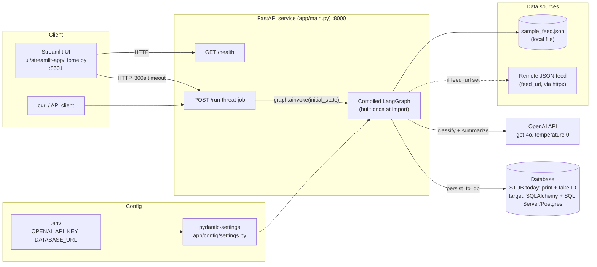
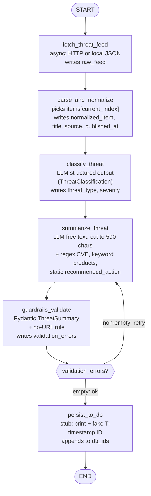
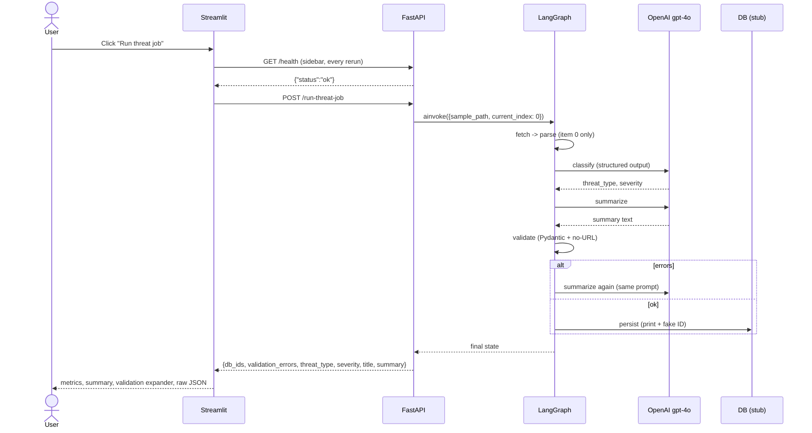
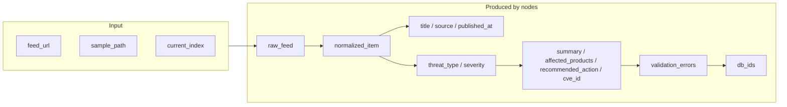

# Backend System Diagram

Diagrams are Mermaid; they render on GitHub and in the VS Code Markdown preview.

## 1. Component / deployment view

## 2. LangGraph pipeline (the core of the backend)

## 3. Request sequence

## 4. Shared state (`ThreatState`, a TypedDict)

